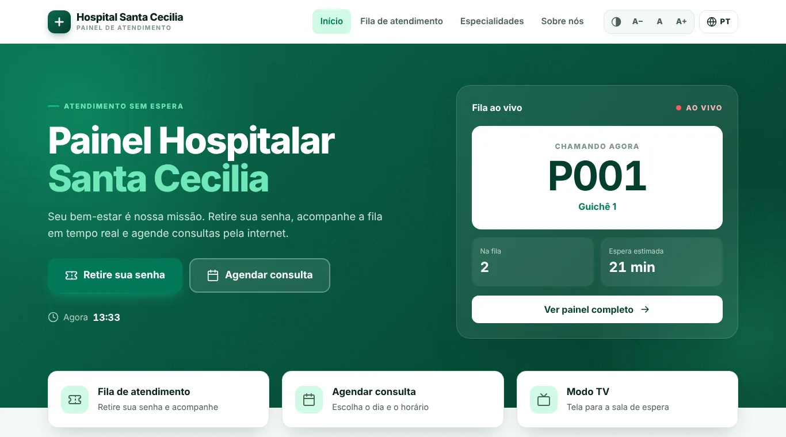
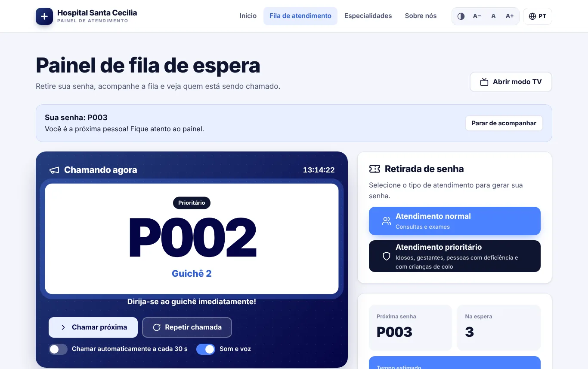
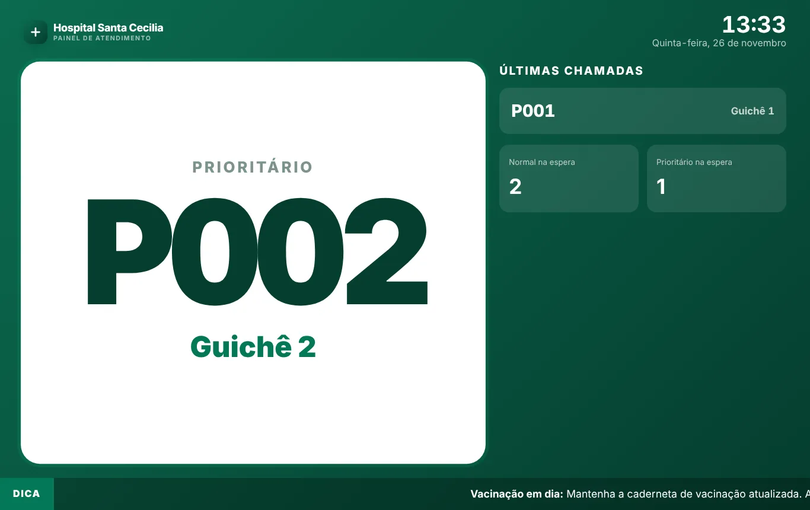
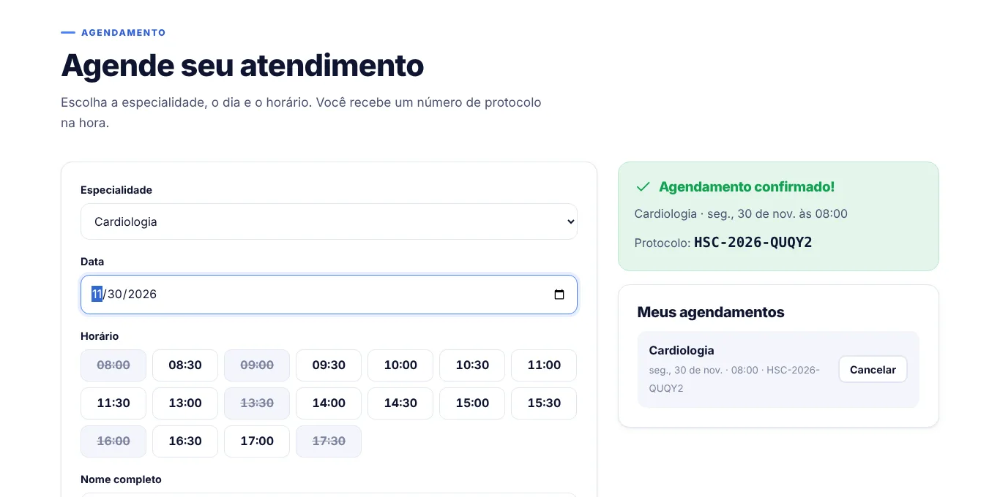

<h1 align="center">Painel de Atendimento · Hospital Santa Cecilia</h1>

<h3 align="center">
  <a href="https://biabruna19.github.io/Painel-de-atendimento/">Ver o site → biabruna19.github.io/Painel-de-atendimento</a>
</h3>

<p align="center">
  
</p>

## Sobre

Um painel de atendimento para um hospital fictício. A ideia é diminuir a fila no balcão: a pessoa retira a senha, acompanha a fila em tempo real e é avisada com som e voz quando chega a vez dela. Também dá para agendar consultas pela internet.

## O que dá para fazer

- **Retirar senha** normal ou prioritária e receber um comprovante, que também pode ser impresso.
- **Acompanhar a fila**: posição, tempo estimado e aviso quando a sua senha é chamada. Os prioritários são atendidos primeiro e, dentro de cada tipo, vale a ordem de chegada.
- **Chamar a próxima senha** como atendente, repetir a chamada ou deixar o painel chamar sozinho a cada 30 segundos. Cada chamada toca um sinal e é anunciada em voz alta.
- **Modo TV**: uma tela para a sala de espera que mostra a senha chamada, as últimas chamadas e dicas de saúde. Aberta em outra aba ou em outro monitor, ela se atualiza sozinha junto com o painel.
- **Agendar consulta**: escolher a especialidade, o dia e um horário livre, e receber um número de protocolo. Os agendamentos ficam listados e podem ser cancelados.
- **Especialidades** com busca, já levando para o agendamento preenchido.
- **Avaliar o atendimento** com estrelas e um comentário.
- **Acessibilidade**: alto contraste, quatro tamanhos de fonte e navegação pelo teclado.
- **Idiomas**: português, inglês e espanhol escritos à mão, e outras línguas pelo globo, com tradução automática.

<p align="center">
  
  
</p>

<p align="center">
  
</p>

## Como testar

1. Abra o [site](https://biabruna19.github.io/Painel-de-atendimento/) e clique em **Retire sua senha**.
2. Retire algumas senhas normais e prioritárias e use **Chamar próxima**.
3. Para ver o modo TV funcionando junto, clique em **Abrir modo TV**, ative o som e volte para a aba do painel.

Tudo fica salvo no navegador de quem está testando: não há servidor nem banco de dados. Por isso o site roda direto no GitHub Pages.

## Tecnologias

HTML, CSS e JavaScript, sem frameworks. A voz usa a Web Speech API do próprio navegador e o sinal sonoro é gerado com a Web Audio API.

A primeira versão era um único arquivo com Tailwind. Nesta versão o projeto foi reorganizado em páginas, com estilos próprios, e ganhou o modo TV, o agendamento com horários e a fila salva no navegador.

## Rodando no computador

```bash
git clone https://github.com/biabruna19/Painel-de-atendimento.git
```

Depois é só abrir o `index.html` no navegador.

## Organização das pastas

```
index.html            início, agendamento, notícias e avaliação
fila.html             painel da fila e retirada de senha
tv.html               modo TV para a sala de espera
especialidades.html   especialidades
sobre.html            história, missão, visão e valores
404.html              página não encontrada
css/estilo.css        estilos
js/                   fila, idiomas, layout e scripts de cada página
docs/                 imagens deste README
```

## Desenvolvido por

**Beatriz Oliveira**<br>
[GitHub](https://github.com/biabruna19) · [LinkedIn](https://www.linkedin.com/in/beatriz-oliveira-759867294/) · [E-mail](mailto:biabruna.1901@gmail.com)

---

O Hospital Santa Cecilia é fictício. Este é um projeto de portfólio.
